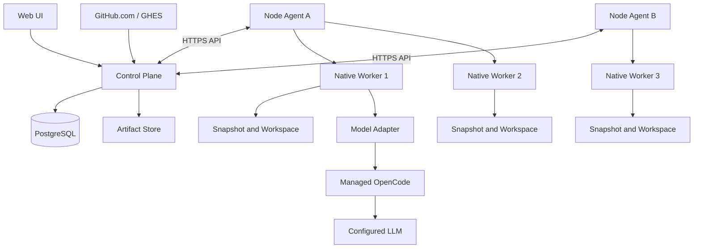

# 03. 시스템 아키텍처

## 1. 배치

개인 모드는 한 PC에 관리 서버·PostgreSQL·에이전트를 둔다. 워커가 다른 노드로 이동해도 관리 API 계약은 같다. NFS는 필수 공용 버스가 아니라 선택적인 소스·산출물 저장 경로다. R0에서는 스냅샷 사본을 노드에 보관하고 manifest와 결과 산출물을 인증된 API로 전송한다. 고정 입력 재시도에는 해당 스냅샷을 보유한 노드가 필요하다.

## 2. 기술 기본안과 대가

| 구성 | 기본안 | 이유·대가 |
|---|---|---|
| 웹 | React·TypeScript 정적 배포 | 코드/필터/실시간 화면에 적합. 대상 브라우저에서 검증 필요 |
| 서버·에이전트·워커 | Go | 계약과 프로세스 관리 코드 공유. OS별 제어 구현 필요 |
| 상태·작업 큐 | PostgreSQL | 트랜잭션과 영속성 통일. 개인 PC에도 DB 설치 필요 |
| 대형 산출물 | local filesystem, NFS 선택 | DB에 소스·대형 로그를 넣지 않음. 추후 object store 어댑터 |
| UI 이벤트 | R0 polling, W22 SSE·polling | 재접속·재시작 복구. 지속 로그는 별도 cursor 사용 |
| LLM | OpenCodeAdapter 우선 | 승인된 모델 경로. 직접 API는 환경에서 허용할 때만 |
| 실행 | NativeExecutor | 컨테이너 없이 동작. 보안 격리는 OS 능력에 의존 |

초기에는 SQLite·PostgreSQL 이중 저장 계층, Redis, Kafka, Kubernetes, 벡터 DB를 필수로 도입하지 않는다. 임베딩 없이 파일 목록·심볼 인덱스·검색·관련 코드 확장으로 시작한다. 설치를 단순화하더라도 DB와 언어 런타임이 필요 없다고 주장하지 않는다.

## 3. 제품 설계의 모듈 경계

| 모듈 | 책임 |
|---|---|
| ProjectService | 소스·설정 revision·소유권·멤버 |
| RunService | 요청 멱등성, 입력 고정, attempt·상태·재시도 |
| Scheduler | 예약·공정한 큐·호환 노드·자원 슬롯 |
| Autoscaler | 풀 정책과 실제 용량으로 워커 목표 수 조정 |
| NodeAgent | heartbeat, 워커 시작/정리, 프로세스 조사, 로컬 spool |
| AnalysisWorker | 한 attempt의 DAG·도구·모델 task 수행 |
| SourceAdapter | Git/local 확보, manifest·source mapping |
| Executor | 명령·환경·자원·시간·프로세스 종료 |
| AnalyzerAdapter | probe, plan, execute spec, parse, normalize |
| ReviewEngine | 컨텍스트·지침 팩·탐색·반증·종합 |
| FindingService | 증거 검증·원인 그룹·비교·사람 검토 |
| ReportService | 구조화 결과에서 웹·Markdown·HTML·JSON |
| GitProvider | Git 정보·App webhook·댓글. CI 기능 없음 |

## 4. 불변조건

1. 워커는 DB를 직접 수정하지 않는다. API가 권한·lease epoch·상태를 검사한다.
2. run은 프로젝트 설정 revision과 소스 snapshot을 참조한다. 소스 확보 전 snapshot은 null이다.
3. 한 attempt는 한 노드에 고정한다. 초기에는 한 run의 task를 여러 노드에 분산하지 않는다. 서로 다른 run은 병렬 분산한다.
4. 워커 내부 병렬 도구도 attempt 자원 예산과 전역 모델 semaphore를 따른다.
5. 최소 워커가 0이어도 관리 서버·에이전트는 살아 있으며 새 요청 시 다시 워커를 만든다.
6. 증거용 입력 snapshot과 도구가 수정 가능한 workspace를 분리한다. 원본 snapshot 경로는 분석 프로세스에 쓰기 대상으로 주지 않는다.
7. 네트워크 분할에서 exactly-once 실행은 주장하지 않는다. fencing으로 오래된 결과의 게시를 차단한다.
8. 프로세스 종료 확인이 안 되면 자동 재실행의 안전성 판단을 별도로 한다. 특히 부작용 가능한 테스트는 즉시 중복 실행하지 않는다.

## 5. 데이터 흐름

인증→프로젝트 revision 동결→run 영속화→워커 용량 확보→호환 노드 배정/lease→소스 확보→snapshot 확정→환경·계획→도구/LLM 관찰→반증→증거 검증→보고서 게시→선택적 Git 댓글 outbox.

상태 변경과 상태 이벤트는 같은 DB 트랜잭션이다. artifact는 임시 업로드 후 hash/size 검증과 finalize를 거친다. 보고서는 참조 artifact가 준비된 뒤 게시한다. 댓글 실패는 notification 상태로 분리하며 완료된 분석을 failed로 바꾸지 않는다.

## 6. 현재 저장소에서 찾는 위치

| 책임 | 코드 |
|---|---|
| CLI·컨트롤러·에이전트·워커 진입점 | [cmd/codeye](../cmd/codeye) 아래 한 바이너리의 하위 명령 |
| 세션·프로젝트·실행 조회 | [HTTP API](../internal/httpapi) · [PostgreSQL 저장 계층](../internal/storage/postgres) |
| 노드 관리·소스 취득·프로세스 종료 | [agent](../internal/agent) · [source](../internal/worker/source) · [executor](../internal/worker/executor) |
| 어댑터·발췌·모델 역할 | [분석기](../internal/worker/analysis) · [검토 워커](../internal/worker/review) · [OpenCode](../internal/worker/opencode) |
| 보고서 게시·표시 | [게시 서비스](../internal/reportsvc) · [보고서 생성](../internal/report) · [프로젝트 웹](../web/src) |

설계에 포함된 예약·Git 이벤트·다중 물리 노드 운영의 구현 시점은 [작업 계획](17-implementation-plan.md)에서 확인한다.
