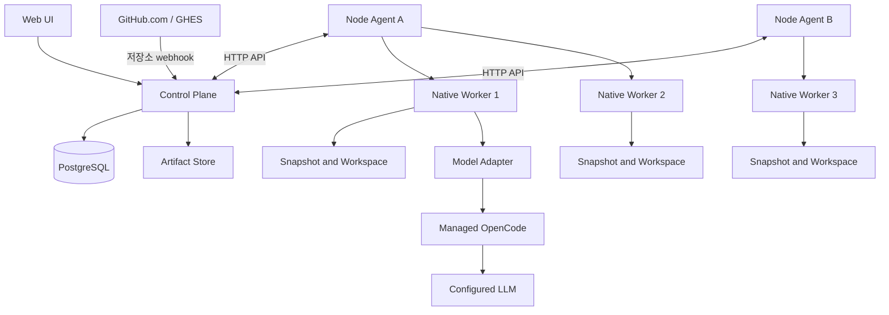

# 아키텍처

관리 서버는 사용자·프로젝트 권한과 작업 큐를 관리한다. 노드 에이전트는 워커를 실행하고, 워커는 플랫폼 계정으로 확보한 소스에서 분석 결과를 만든다. 실행 정책은 [실행](EXECUTION.md), 분석기와 모델의 입력은 [분석기](ANALYZERS.md)와 [모델 검토](REVIEW.md)에 있다.

## 배치



- `codeye up`은 한 머신에 관리 서버(controller)·PostgreSQL·노드 에이전트를 두고, 같은 서비스를 다른 머신의 사용자에게도 연다([운영](OPERATIONS.md)). 워커가 다른 노드로 옮겨도 관리 API 계약은 같다.
- 노드 에이전트는 controller의 HTTP API에 outbound로 연결한다. loopback과 운영자가 명시한 평문 HTTP를 제외하면 TLS를 사용한다. 노드와 워커는 DB에 접근하지 않는다.
- 스냅샷 사본은 그것을 만든 노드에 남는다. manifest와 결과 산출물만 인증된 API로 controller에 전송한다. 그래서 고정 입력 재시도에는 그 스냅샷을 보유한 노드가 필요하다. 노드 간 스냅샷 전송은 없다.
- NFS는 필수 공용 버스가 아니다. 선택적인 소스 경로일 뿐이다.
- 플랫폼 계정으로 저장소와 PR을 읽는다. 저장소 웹훅은 분석을 요청하고, 관리 서버는 결과 댓글을 전송한다. 조직 단위 GitHub App 설치는 후속 작업이다. [GitHub 연동](GITHUB.md)

## 기술 선택

| 구성 | 선택 | 이유와 대가 |
|---|---|---|
| 웹 | React·TypeScript 정적 배포 | 코드·필터·실시간 화면에 맞다. 대상 브라우저마다 검증이 필요하다. |
| 서버·에이전트·워커 | Go 한 바이너리(`codeye`)의 하위 명령 | 계약과 프로세스 관리 코드를 공유한다. OS별 프로세스 제어는 따로 구현한다. |
| 상태·작업 큐 | PostgreSQL | 트랜잭션과 영속성을 하나로 둔다. 개인 PC에도 DB 설치가 필요하다. |
| 대형 산출물 | 로컬 파일시스템의 내용 주소 저장소 | 소스·대형 로그를 DB에 넣지 않는다. object store 어댑터는 없다. |
| UI 갱신 | SSE와 polling 대체 | 재접속·재시작 뒤 같은 상태로 복원한다([API](API.md)). |
| 모델 | 관리되는 OpenCode 경로 | 승인된 모델 경로만 쓴다([검토](REVIEW.md)). |
| 실행 | Native 실행기 | 컨테이너 없이 동작한다. 보안 격리는 OS 능력에 달려 있다([실행](EXECUTION.md)). |

SQLite·PostgreSQL 이중 저장 계층, Redis, Kafka, Kubernetes, 벡터 DB를 필수로 두지 않는다. 임베딩 없이 파일 목록·발췌·관련 코드 확장으로 문맥을 만든다. 설치를 단순화해도 DB와 언어 런타임이 필요 없다고 주장하지 않는다.

## 구성 요소와 코드 위치

| 구성 요소 | 책임 | 코드 |
|---|---|---|
| 진입점 | CLI·controller·에이전트·워커 하위 명령 | [cmd/codeye](../cmd/codeye) |
| 프로젝트·실행 서비스 | 소스·설정 revision·구성원, 요청 멱등성, 입력 고정, attempt·상태 | [httpapi](../internal/httpapi), [storage/postgres](../internal/storage/postgres), [domain](../internal/domain) |
| 배정(scheduler) | 호환 노드·자원 예약·공정 순서 | [claim.go](../internal/storage/postgres/claim.go) |
| 자동 증감(autoscaler) | 풀 정책과 실제 용량으로 워커 수 조정 | [scheduler.go](../internal/storage/postgres/scheduler.go) |
| 예약 | cron·시간대·occurrence materialize | [schedule](../internal/schedule), [schedules.go](../internal/storage/postgres/schedules.go) |
| 노드 에이전트 | heartbeat, 워커 시작·정리, journal, 프로세스 조사 | [agent](../internal/agent), [nodeproto](../internal/nodeproto), [workerproto](../internal/workerproto) |
| 분석 워커 | 한 attempt의 소스 확보·계획·task 실행 | [worker/run](../internal/worker/run) |
| 소스 어댑터 | Git·로컬 확보, manifest, 작업 사본 | [worker/source](../internal/worker/source) |
| 실행기 | argv·환경·시간·출력·프로세스 종료 | [worker/executor](../internal/worker/executor) |
| 탐색 | 모듈·환경·문서 사실 | [worker/discovery](../internal/worker/discovery) |
| 분석기 어댑터 | probe, plan, 실행, parse, 정규화 | [worker/analysis](../internal/worker/analysis) |
| 검토 엔진 | 문맥·지침 팩·탐색·반증 | [worker/review](../internal/worker/review), [worker/opencode](../internal/worker/opencode) |
| 기존 테스트 | 테스트 진입점·실행·구조화 케이스·소스 위치 | [worker/testexec](../internal/worker/testexec) |
| 진행 단계 | 저장 기록에서 단계 상태 계산 | [progress](../internal/progress) |
| 발견 비교·사람 판정 | fingerprint, run 비교, 판정 | [history](../internal/history) |
| 보고서 | 구조화 결과에서 웹·Markdown·HTML·JSON | [reportsvc](../internal/reportsvc), [report](../internal/report), [web/src](../web/src) |
| GitHub 연동 | 플랫폼 계정, PR 조회, 저장소 웹훅·결과 댓글 | [github](../internal/github), [httpapi](../internal/httpapi) |

## 불변조건

1. 워커는 DB를 직접 수정하지 않는다. API가 권한·lease epoch·상태를 검사한다.
2. run은 프로젝트 설정 revision과 소스 snapshot을 참조한다. 소스 확보 전 snapshot은 null이다.
3. 한 attempt는 한 노드에 고정한다. 한 run의 task를 여러 노드에 나누지 않는다. 서로 다른 run은 병렬로 분산한다.
4. 워커 내부의 병렬 도구도 attempt 자원 예산을 따른다. 한 attempt 안의 모델 요청은 검토 쌍의 병렬도(`review_parallel`)까지 함께 실행한다([호출 상한과 승인](REVIEW.md#호출-상한과-승인)). 노드·endpoint 전체에 걸친 모델 semaphore는 설계 계약(미구현)이다.
5. 최소 워커가 0이어도 관리 서버·에이전트는 살아 있고, 새 요청이 오면 워커를 다시 만든다.
6. 증거용 입력 snapshot과 도구가 수정할 수 있는 workspace를 분리한다. snapshot 경로를 분석 프로세스의 쓰기 대상으로 주지 않는다.
7. 네트워크 분할에서 exactly-once 실행을 주장하지 않는다. fencing으로 오래된 결과의 게시를 막는다.
8. 프로세스 종료를 확인하지 못하면 자동 재실행하지 않는다. 특히 부작용이 있을 수 있는 테스트는 중복 실행하지 않는다.
9. 상태 변경과 그 상태 이벤트는 같은 DB 트랜잭션이다.
10. 상태·통계는 구조화 데이터에서 결정한다. LLM이 "끝났다"고 썼다는 이유로 완료하지 않는다.

## 데이터 흐름

인증 → 프로젝트 revision 동결 → run 영속화 → 호환 노드 배정·lease → 소스 확보와 snapshot 확정 → task 계획 → 탐색·정적 분석·코드 조사 → 선택한 기존 테스트 → 관련 근거 검증 → 보고서 게시.

- artifact는 업로드 후 hash·크기 검증을 거쳐 finalize된다. 보고서는 참조하는 artifact가 준비된 뒤 게시한다([보고서](REPORT.md)).
- PR 댓글 전송은 보고서 게시 후 별도 큐에서 처리한다. 전송 실패는 댓글 상태에 기록하고 게시된 보고서를 유지한다. [결과 댓글](GITHUB.md#결과-댓글)

## 분석 파이프라인

### 단계와 산출물

작업 순서는 프로필의 계획에서 정한다. 화면의 분류와 표시 순서는 [진행 단계 판정](#진행-단계-판정)을 따른다.

| 단계 | 산출물 | 주요 실패 처리 | 상태 |
|---|---|---|---|
| acquire | snapshot, source SHA, manifest | 접근 실패·불안정 복사면 failed | 구현 |
| plan | task 목록(key·필수 여부·단계·가중치) | 미지원 검사는 사유를 기록 | 구현(DAG 필드는 일부) |
| discover | 모듈 지도·환경 사실·문서 맥락 | 문서 없음은 정상, 읽지 못한 범위 표시 | 구현 |
| prepare | 실행 사본·런타임·도구 manifest, 모듈별 의존성 기록 | 의존성 준비 실패는 그 task만 끝내고 분석 계속 | Go·Rust·JS/TS·Python 의존성 받기 구현, C/C++는 CMake configure로 compile DB만 만든다(저장소 코드 실행 허가 필요). C/C++ 의존성 받기와 빌드는 설계 계약(미구현) |
| analyze | 도구 observation, 맥락 중심 가설 | task별 제한시간과 부분 실패 | 구현 |
| verify | 지지·기각·보류와 반대 근거 | 예산 종료 시 미검증 유지 | 구현 |
| test | 기존 테스트 실행 기록, 케이스별 결과와 확인된 소스 위치 | 미실행·실패·시간 초과 사유를 기록 | `with-tests`에서 구현, Linux 전용 loopback 필요 |
| finalize | 결과 manifest, 산출물 확정, 프로세스 정리 확인 | 정리 미확인은 `recovery_required` | 구현 |
| synthesize | 발견 집계와 범위·한계 | 검증한 근거를 사용 | 구현 |
| report | 구조화 보고서와 JSON·Markdown·HTML 내보내기 | 산출물을 확인하지 못하면 상태와 사유를 기록 | 구현 |

`deep-review`는 계획을 확정한 뒤 탐색(`env.discover`, `docs.discover`), 선택한 의존성 준비(`deps.*`), 분석기 팩, 모델 검토 순으로 작업을 실행한다. `with-tests`는 기존 테스트 작업(`test.*`)을 추가한다. 모델 검토를 켜면 첫 후보 검증 직전에 테스트를 수행한다. 워커가 접수한 케이스 중 검토 입력의 테스트 줄과 연결된 상태를 후보 검증에서 참조할 수 있다. 테스트에서 사용할 의존성은 분석기가 없어도 준비할 수 있다. [의존성 준비](#의존성-준비) · [분석기](ANALYZERS.md) · [검토](REVIEW.md) · [기존 테스트 실행](EXECUTION.md#기존-테스트-실행)

### task 계획 계약

워커가 보내는 `task_created`는 `key`(run 안에서 유일), `required`, 선택 `stage`, 선택 `weight`를 가진다. 같은 key를 다시 보내면 기존 task와 현재 version을 돌려준다(재시도 계획의 재사용). 단계·가중치의 한 번 기록 규칙은 [단계 기록 규칙](#단계-기록-규칙)에 있다.

task ID·kind·purpose·scope·depends_on·required_for_verdict·capabilities·resource_request·budget·completion_contract를 갖는 완전한 DAG는 설계 계약(미구현)이다([plan schema](../schemas/plan.schema.json), [예시](../examples/plan.json)). 그 계약의 규칙은 다음과 같다.

- task ID는 run 안에서 유일하고 순환이 없다. plan revision은 검사 추가·범위 변경 때 오르고 기존 task ID와 완료 이력을 유지한다. 현재 구현의 계획 revision은 확정 뒤 추가된 task 수로 계산한다([API](API.md)).
- 같은 workspace를 수정하는 prepare·build는 write lease를 갖고 병렬화하지 않는다. 읽기 전용 분석끼리는 병렬화할 수 있다.
- 테스트·빌드가 파일을 바꾸면 독립 workspace나 단계 간 source-drift 검사를 쓴다. 여러 task가 같은 파일의 변경된 버전을 원본처럼 읽지 않는다.

### 독립 탐색과 도구 해석

- 맥락 중심 검토에는 진단 목록을 보기 전의 예산을 보장한다. 진단 중심 검토는 발생 조건·영향을 확장한다. 이후 verify가 두 경로를 교차 검토한다.
- 역할 분리는 같은 모델의 판단을 통계적으로 독립되게 만드는 장치가 아니다.
- LLM이 추가 검사를 제안하면 등록된 도구·예산·실행 권한 안에서만 task로 바꾼다. 자유 shell 명령을 관리 서버에서 실행하지 않는다. 수행할 수 없는 제안은 사유와 함께 남긴다. 제안을 task로 바꾸는 경로는 설계 계약(미구현)이다.

### 실패와 재시도 정책

| 상황 | 정책 |
|---|---|
| finding을 뜻하는 종료 코드 | 어댑터의 코드 매핑에 따라 succeeded와 observations |
| parser 오류 | raw 보존, `parser_error`, 0건 주장 금지 |
| 모델 timeout·429 | 제한된 재시도, 예산이 끝나면 partial |
| 잘못된 JSON·증거 참조 | 형식 복구 요청 후에도 틀리면 격리([검토](REVIEW.md)) |
| 노드 lease 만료 | fenced, recovery_required. 부작용 가능한 작업은 종료 확인 전 재시도 금지 |
| Git 댓글 실패 | 보고서를 유지하고 전송 정책에 따라 댓글 큐에서 재시도 |
| 원본과 workspace 불일치 | 변경 파일과 이유 기록, 오래된 근거 invalid |

재시도 attempt는 이미 고정한 snapshot과 설정 revision을 유지한다. 입력을 새로 가져오려면 새 run을 만든다. snapshot이 없으면 같은 입력 재실행을 거부한다. 재시도 규칙은 [재시도](#재시도)에 있다.

### 캐시

설계 계약(미구현)이다. 성공 결과 재사용은 없다.

- 도구 키: snapshot, module, tool version, rule digest, target runtime·ABI, flags, lock digest, adapter version, environment policy.
- 모델 키: 도구 키에 pack digest, 모델 identity·가용 revision, decoding, context hash를 더한다. 모델 revision을 모르면 unknown으로 저장하고 TTL로 제한한다.
- 같은 입력에서도 비결정적 모델 출력의 bitwise 재현은 보장하지 않는다.
- 실패·부분 파싱은 성공 캐시로 쓰지 않는다. 프로젝트별 namespace와 권한을 적용한다.
- 소스가 같아도 지침·규칙·모델이 바뀌면 다시 검토한다. 이전 결과를 재사용하면 실행 날짜와 재사용 근거를 보여 준다.

### 종료 조건

요청한 task가 모두 종료 상태이고, 참조 artifact가 finalize되고, 워커가 소유한 프로세스의 종료 결과를 보고했을 때만 완료를 확정한다. 완료 상태 판정과 보고서 생성은 서버가 한다.

## 상태 전이

상태 enum의 기준은 [state schema](../schemas/state.schema.json)와 [`internal/domain/status.go`](../internal/domain/status.go)다. [상태 예시](../examples/state.json)는 정리가 불확실할 때 task가 running으로 남을 수 있음을 보여 주는 합성 데이터다.

### run 상태

| 현재 | 허용된 다음 상태 |
|---|---|
| `queued` | `preparing`, `failed`, `cancelled`, `cancel_requested` |
| `preparing` | `running`, `failed`, `cancel_requested`, `recovery_required` |
| `running` | `finalizing`, `failed`, `cancel_requested`, `recovery_required` |
| `finalizing` | `completed`, `partial`, `failed`, `cancel_requested`, `recovery_required` |
| `cancel_requested` | `cancelling`, `recovery_required` |
| `cancelling` | `cancelled`, `recovery_required` |
| `recovery_required` | `queued`(명시적 재시도 서비스만), `failed` |
| `completed`·`partial`·`failed`·`cancelled` | 없음(종료) |

- `queued` → `cancelled`는 해제되지 않은 attempt가 없을 때만 바로 간다. 그 외 활성 상태의 취소는 `cancel_requested`를 거친다. `recovery_required`인 run의 취소는 409다.
- `completed`·`partial`은 `finalizing`에서만 간다. 성공한 attempt를 수용하면 run은 `finalizing`으로 가고, 서버가 보고서를 게시하며 `completed`나 `partial`을 정한다([보고서](REPORT.md)).
- `completed`는 요청한 필수 작업이 성공하고 산출물이 게시된 상태다. `partial`은 읽을 수 있는 결과가 있으나 필수 작업 일부가 수행되지 않은 상태다. `failed`는 입력 확보 실패 등으로 의미 있는 결과가 없는 상태다. 탐색만 성공하고 정적 분석이 모두 실패한 실행도 탐색 사실이 남으므로 `partial`이다.
- 선택 작업의 실패도 보고서에 드러낸다.
- `quality_verdict`(`attention_required`, `no_actionable_findings`, `inconclusive`)는 run 상태와 별개다. 필수 범위가 빠지면 결함 후보가 있더라도 완전한 품질 판정으로 표현하지 않는다. 주요 발견과 판정 보류를 함께 표시할 수 있다. 판정 규칙은 [보고서](REPORT.md)에 있다. 이 필드는 안전 인증이 아니다.

### task 상태

`queued`, `blocked`, `running`, `succeeded`, `failed`, `timed_out`, `cancelled`, `unsupported`, `skipped_policy`, `budget_exhausted`.

- `blocked`는 선행조건을 기다리는 비종료 상태다. 선행조건이 최종 실패하면 `skipped_policy` 또는 `failed`로 바꾸고 `reason=dependency_failed`를 남긴다.
- `running`은 `queued`로 돌아가지 않는다. lost attempt 뒤의 재실행은 새 execution이다.
- `unsupported`와 `skipped_policy`는 종료 상태지만 성공 검사 수에 넣지 않는다.
- 사유 코드는 `^[a-z][a-z0-9_]{0,63}$` 형식의 열린 어휘다. task key는 `^[a-z][a-z0-9_.-]{0,63}$`다.

### attempt 상태와 정리

| 항목 | 규칙 |
|---|---|
| `attempt.status` | `leased` / `recovery_required` / `released` |
| `cleanup_state` | `pending` / `uncertain` / `confirmed`. `released`에는 `confirmed`가 필수다. |
| 활성 소유권 | 한 run에서 `leased` 또는 `recovery_required`인 attempt는 최대 하나다. |
| epoch | 배정마다 오른다. node·worker·attempt·epoch와 DB 시각을 잠금 안에서 검사한다. |
| 만료 | `recovery_required`로 fence한다. 프로세스 종료와 같은 뜻이 아니다. |
| 정리 재조정 | 소유 노드가 `confirmed`를 보고하면 `released`, run은 `failed`가 된다. 그 뒤 명시적 재시도가 가능하다. |
| 완료 재전송 | 같은 소유자·epoch·payload만 멱등 응답한다. 새 attempt나 재시도 뒤에는 받지 않는다. |

lease·만료·정리 보고의 프로토콜은 [실행](EXECUTION.md)에 있다.

### 재시도

- `failed`·`cancelled` run만 재시도 서비스로 `queued`가 된다. 고정 snapshot이 있어야 하고 모든 attempt가 `released`·`confirmed`여야 한다. 입력과 설정 revision은 그대로다.
- 일반 상태 전이 함수로 종료 상태를 되돌리지 않는다. `completed`·`partial` 재시도는 없다.
- 재시도는 logical task를 `queued`로 되돌리고 사유·시작·종료 시각을 비운다(단계는 유지). 이전 attempt의 기록은 `task_executions`와 이벤트에 남는다. 확인된 실패·취소 정리에서는 미종료 task·execution도 종료 처리한다. 불확실한 정리에서는 실행 중일 가능성을 남긴다.
- 재시도한 run의 job은 `snapshot`을 함께 받고, 워커는 소스를 다시 가져오지 않는다([실행](EXECUTION.md)).
- 이 재시도 서비스(`Store.Retry`)는 저장 계층에만 있다. HTTP API·CLI·웹으로는 노출하지 않는다. `recovery_required` → `queued`를 수행하는 경로도 없다.

### 발견 상태

`finding.validation`(`unreviewed`, `supported`, `reproduced`, `refuted`, `inconclusive`)과 사용자 처리 상태(`disposition`)는 서로 독립이다. 정의와 사람 판정은 [보고서](REPORT.md)에 있다.

## 소스 확보와 스냅샷

[`internal/worker/source`](../internal/worker/source)는 `AcquireLocal`, `AcquireGit`, `Load`, `CloneWorkspace`를 제공한다. 입력은 승인 root와 상대 경로 또는 승인된 Git host·브랜치, 플랫폼 data root, 파일·용량·재시도 한도다. 결과는 snapshot 디렉터리, 별도 writable workspace, manifest, 입력 digest다. snapshot ID와 프로젝트·attempt 소유권 연결은 controller가 맡는다.

- 관리 서버가 웹 사용자의 프로젝트 권한을 검사한다. 파일 읽기에는 서비스 Linux 계정, Git 읽기에는 플랫폼 GitHub 계정의 권한을 사용한다. 노드는 자신에게 배정된 attempt와 소스 범위로 작업한다.
- 이 API는 shell 문자열을 받지 않는다.

### 등록과 접근

- Git 등록은 provider ID·repository URL·branch를 저장한다. 로컬 등록은 source root ID와 그 아래 상대 경로를 저장한다. 서비스 머신의 워커는 컨트롤러가 기록한 서버 경로를 사용한다. 별도 노드는 운영자가 지정한 로컬 매핑을 사용한다.
- 서비스는 입력한 폴더를 실제 경로로 해석하고 Linux 계정의 접근을 확인한 뒤 프로젝트 소스로 등록한다. NFS 마운트에도 같은 절차를 적용한다.
- 브라우저 PC의 경로와 서버·노드의 경로를 혼동하지 않는다. NFS의 같은 경로가 모든 노드에서 같은 권한으로 보인다고 가정하지 않는다.
- `codeye up`의 내장 노드는 관리 서버가 확인한 로컬 경로와 승인한 Git 호스트를 작업에서 받는다. 따로 등록한 노드는 운영자가 지정한 root·호스트를 상한으로 삼는다. [플랫폼 소스 계정](GITHUB.md) · [운영](OPERATIONS.md)

### 로컬 사본

- 커밋 여부와 무관하게 선택한 파일을 복사한다.
- 승인 root와 선택 경로를 실제 경로로 해석해 root 밖 링크·절대 경로·상위 이동을 거부한다. 이 검사는 친절한 오류용이며 신뢰하지 않는다. 실제 열기는 승인 root를 `os.Root`로 연 뒤 같은 root 안에서 상대 경로를 다시 연다(`Root.OpenRoot`). 검증 뒤에 경로 구성 요소가 root 밖을 가리키는 symlink로 바뀌어도 밖으로 나가지 않고 `invalid_source`로 끝난다.
- 파일 열기·순회도 같은 경계에서 한다. symlink·device·socket·FIFO는 따라가지 않고 복사하지 않는다.
- 플랫폼 data root는 승인 root 전체의 바깥이어야 한다. 승인 root의 형제·하위·상위·root 자체를 모두 거부한다. 기존 부모의 symlink를 풀어 비교하므로 별칭으로 원본 쪽에 쓰지 못한다. 승인 root나 data root가 상대 경로이면 거부한다.
- Linux에서는 파일을 `O_NONBLOCK`으로 연다. 스캔 뒤 일반 파일이 FIFO로 바뀌어도 open이 멈추지 않고, 열린 뒤 종류 검사에서 변경으로 판정된다. 다른 OS는 이 보호를 주장하지 않는다.
- 읽기는 64 KiB 단위로 취소를 확인한다. 이미 시작한 단일 `read(2)`·`open(2)`(예: 응답하지 않는 NFS hard mount)는 중단할 수 없다. 이 한계를 성공이나 timeout 보장으로 표시하지 않는다.
- 복사 전 파일 집합·종류·크기·mode·mtime·identity를 기록하고, 파일 읽기 전후와 전체 복사 뒤에 다시 비교한다. 변화가 있으면 기본 2회 재시도하고, 계속 바뀌면 `source_unstable`이다.
- stat·read는 원자적 snapshot이 아니다. 같은 크기·mtime으로 되돌린 동시 수정을 입증하지 못한다. 그래서 로컬 consistency는 항상 `stable_copy_best_effort`다. 파일시스템 snapshot을 쓰는 강한 일관성 어댑터는 설계 계약(미구현)이다.
- 대소문자 충돌·Windows 예약 파일명·잘못된 UTF-8 경로는 덮어쓰지 않고 unsupported로 드러낸다.
- 외부 입력을 별도 승인 root로 등록해 명시적으로 복사하는 기능과 아카이브 추출은 설계 계약(미구현)이다. 아카이브 추출에는 경로 탈출·링크·확장 용량 제한을 적용해야 한다.

### 기본 제외 정책

이름 기반 정책이며 비밀정보 검사가 아니다. 비밀정보 탐지는 [분석기](ANALYZERS.md)에 있다. 제외 경로와 사유 코드(`generated_or_cache`, `credential_directory`, `secret_file_policy`)를 manifest에 남긴다. 로컬과 Git에 같은 정책을 적용한다.

| 범위 | 이름 | 사유 |
|---|---|---|
| 어느 깊이에서든 | `.git`, `.codeye`, `node_modules`, `__pycache__` | `generated_or_cache` |
| 선택한 트리의 최상위에서만 | `build`, `dist`, `target`, `venv`, `.venv` | `generated_or_cache` |
| 하위의 `venv`·`.venv` | 그 안에 `pyvenv.cfg`가 있을 때만(로컬은 파일 확인, Git은 트리 경로 확인) | `generated_or_cache` |
| credential 디렉터리 | `.ssh`, `.aws`, `.gnupg`, `.docker`, `.kube`, `.azure`, `.gcloud` | `credential_directory` |
| 경로 구성 요소 이름 | `.env`, `.env.*`(`.env.example`·`.env.sample` 제외), `*.pem`, `*.key`, `id_rsa`, `id_ed25519` | `secret_file_policy` |
| 파일 이름 | `.npmrc`, `.yarnrc`, `.yarnrc.yml`, `.netrc`, `_netrc`, `.git-credentials`, `.pypirc`, `.pgpass`, `.htpasswd`, `htpasswd`, `.dockercfg`, `kubeconfig`, `.vault_pass`, `.vault-pass`, `id_dsa`, `id_ecdsa`, 파일 `credentials`, `credentials.{json,yml,yaml,toml,ini}`, `secrets.{json,yml,yaml,toml,ini}`, `service-account*`·`service_account*`·`serviceaccount*` JSON, `*.p12`, `*.pfx`, `*.pkcs12`, `*.jks`, `*.keystore`, `*.kdbx`, `*.ppk`, `*.tfstate`, `*.tfstate.backup`, `*.tfvars` | `secret_file_policy` |

- `internal/build`, `src/dist`, `cmd/target` 같은 소스 패키지와 `credentials`라는 이름의 디렉터리(SDK 패키지 등)는 유지한다.
- 정책에 걸리지 않는 이름의 비밀 파일은 복사된다. 이 정책이 그것을 막는다고 주장하지 않는다.
- 생성 헤더·vendored code 같은 예외를 사용자가 추가하는 기능은 설계 계약(미구현)이다. 고정 기본 정책을 자동으로 넓히지 않는다.

### Git 확보

- 운영자가 승인한 HTTPS host와 branch만 받는다. URL userinfo·query·fragment, SSH·`git://`, 알려지지 않은 host와 redirect는 거부한다. 별도로 승인한 로컬 Git root(`AllowedLocalRoot`)도 받는다. 로컬 Git root가 있으면 data root는 그 root 전체의 바깥이어야 하며 상대 경로는 거부한다.
- 실제 fetch 시점에 관찰한 commit SHA를 고정한다. 대기 중 새 커밋이 생기면 확보 시점의 커밋을 쓴다. 고정 뒤의 브랜치 이동·force push는 snapshot을 바꾸지 않는다.
- 임시 bare 저장소에서 fetch → rev-parse → ls-tree → cat-file을 argv로 실행한다. snapshot·workspace에 `.git`을 넣지 않는다. checkout·hooks·smudge/clean filter·export-ignore를 쓰지 않는다. Git 사용자·system 설정과 credential helper를 차단한다.
- 받은 객체를 `transfer.fsckObjects`·`fetch.fsckObjects`로 검사한다. `.git` 항목 같은 변조 트리는 fetch 단계에서 정상 실패로 거부한다(recovery가 아니다).
- submodule은 미확보 항목으로, LFS는 pointer 파일과 limitation으로 기록한다. pointer bytes를 실제 대형 파일 내용으로 분석했다고 표시하지 않는다. 환경 산출물과 보고서가 이 limitation을 이어받는다.
- `GitOptions.Timeout`은 개별 명령이 아니라 확보 전체의 deadline(최대 10분)이다. 모든 git 명령, 객체 추출, manifest 작성이 함께 쓴다. 명령별 출력 byte 상한도 있다.
- fetch 중에는 임시 저장소의 쓰기 용량을 0.2초 간격으로 확인해 `MaxTotalBytes`+25%+1 MiB를 넘으면 process group을 중지한다. 이는 polling 기반 soft 감시이며 filesystem quota가 아니다. 빠른 전송은 중지 전에 한도를 넘겨 쓸 수 있고, fetch 뒤의 정확한 객체 크기 검사를 대신하지 않는다.
- 취소·timeout·용량 중지에서는 정리 완료를 확정하지 않고 `recovery_required`와 격리 디렉터리를 반환한다. 용량 중지는 `source_limit_exceeded`이면서 `recovery_required`다. recovery 디렉터리는 자동 재사용·삭제하지 않는다.
- Linux는 git 명령의 process group을 중지한다. 다른 OS의 Git 자식 트리 종료 보증과 NFS의 중단 불가능한 kernel I/O는 검증하지 않았다.
- 비공개 저장소 fetch에는 승인한 호스트에 해당하는 플랫폼 인증정보를 쓴다. 내장 노드는 서비스의 인증 파일과 CA 번들을 사용하고, 별도로 시작한 노드는 운영자가 설정한 `--git-credential-file`과 `--ca-bundle` 경로를 사용한다. 인증이 필요한 요청이 실패하면 해당 사유를 기록한다. 노드에 요청마다 자격증명을 발급하거나 호스트별 CA·proxy profile을 배포하는 기능은 후속 작업이다. [플랫폼 GitHub 계정](GITHUB.md#플랫폼-github-계정) · [사내 CA](OPERATIONS.md#사내-ca)
- PR 요청은 서버에서 base·head SHA와 변경 파일을 고정한다. 워커는 base 저장소의 `refs/pull/N/head`를 가져와 고정한 head와 대조한다. ref가 이동하면 고정 SHA를 다시 요청하고 확보할 수 없으면 실패한다. 분석 대상은 고정 head의 소스다. [PR 분석](GITHUB.md#pull-request-분석)
- submodule·LFS 객체 다운로드와 bare cache는 설계 계약이다. 다른 호스트·저장소의 submodule에는 접근 정책을 다시 적용하고, bare cache는 credential 범위별로 나눈다.

### manifest와 입력 digest

[manifest schema](../schemas/snapshot-manifest.schema.json)는 상대 경로·종류·크기(또는 null)·SHA-256·mode·encoding 힌트·제외 이유·source SHA·(Git) `source_branch`(pull request는 대신 `source_ref`)와 `requested_at`·고정 시각(`source_fixed_at`)·`limitations`를 정의한다. [로컬 예시](../examples/snapshot-manifest.json)와 [Git 예시](../examples/snapshot-manifest-git.json)는 합성 값이다.

- manifest에는 원본 절대 경로, URL, remote 이름, clone credential을 넣지 않는다. provider repository ID도 manifest에는 없다.
- `manifest.json`은 전체 manifest의 canonical JSON(키 정렬, 공백 없음)이다.
- 입력 digest는 저장된 그 `manifest.json` bytes의 SHA-256이다. 그래서 고정 시각·`requested_at`·`limitations`·모든 entry를 포함한다. 같은 내용을 새로 확보하면 시각이 달라 새 digest가 생긴다(파일 hash는 같다). 보존한 snapshot의 재시도·재복사는 같은 digest를 유지한다. 별도 입력 캐시 digest는 없다.
- 출력 위치는 snapshot 상대 경로로 바꾸고, 생성 파일은 artifact로 따로 가리킨다. 원본 NFS 절대 경로는 보고서에 기본 노출하지 않는다.
- snapshot kind와 consistency 조합은 `local`/`stable_copy_best_effort`(source SHA null) 또는 `git`/`git_commit`(source SHA 40 또는 64자리 hex)이다.

### 스냅샷 검증과 작업 사본

- `Load`는 controller에 저장한 digest와 파일 bytes를 대조한다. canonical 형태가 아니거나, 알 수 없는 필드·잘못된 종류·정렬 위반·schema 위반(예: git인데 branch 없음)이면 `snapshot_integrity_failed`로 거부한다. limitations·시각·entry 중 하나만 바뀌어도 탐지한다.
- `CloneWorkspace`는 보존 파일의 bytes·hash를 다시 확인한다. 목적지의 실제 경로가 관리 data root 밖이거나 원본 쪽이면 거부한다. 누락·변조된 snapshot은 다른 원본으로 대체하지 않고 실패한다.
- snapshot과 workspace는 byte copy다. hard link를 공유하지 않는다. reflink·CoW는 실제 분리 동작을 검증한 경우에만 최적화로 쓸 수 있다(현재 쓰지 않음).
- workspace 수정은 원본·snapshot을 바꾸지 않는다. 파일 readonly는 관리 정책이며, 같은 OS 계정의 악성 코드를 막는 샌드박스가 아니다. snapshot 변조 여부는 hash 검사로 판단한다.

### 노드의 저장 위치

에이전트 state 디렉터리 아래에 다음을 만든다. 영역별 저장 상한은 [운영](OPERATIONS.md)에 있다.

```text
<state-dir>/
  node.json            # 노드 credential(0600)
  agent.lock           # 같은 state dir의 두 번째 agent 차단
  journal.jsonl        # 프로세스 journal
  snapshots.jsonl      # snapshot 위치(에이전트 비공개, 서버에 보내지 않음)
  data/
    acquire-*/         # 한 번의 소스 확보
      snapshot/        # 확정 입력. 증거의 기준
      workspace/       # 분석·도구용 사본
      manifest.json
    ws-<attempt_id>/   # 고정 snapshot 재시도의 새 workspace
  workers/<worker_id>/
    home/  tmp/  scratch/   # 워커 home·임시·attempt scratch
```

실행기는 task마다 scratch 아래에 실행별 home·temp를 만든다([실행](EXECUTION.md)).

### 한도

| 한도 | 기본값 |
|---|---|
| manifest 항목 | 50,000 |
| manifest JSON | 16 MiB |
| 파일 하나 | 16 MiB |
| 전체 | 512 MiB |
| 변경 감지 재시도 | 2회(0~5) |
| Git 확보 deadline | 최대 10분 |

한도를 넘은 파일을 성공한 분석 범위에 몰래 넣지 않는다. 실패를 0개 파일 검사 성공으로 바꾸지 않는다. 재시도 workspace는 같은 승인 data root 아래의 새 경로만 허용한다.

### 보존과 재실행

- 새로 분석하면 새 입력을 고정한다(새 run). 같은 입력 재실행은 보존된 snapshot과 설정 revision을 쓴다.
- snapshot은 만든 노드의 `data/` 아래에 남고 그 노드의 `snapshot_locations` 행으로 기록된다. 고정 snapshot 재시도는 그 노드에만 배정된다. 보유 노드가 철회되면 `snapshot_unavailable`이다.
- snapshot cache GC, 보관 기간 만료, 노드 간 snapshot 전송은 없다. 공간 정리는 운영자가 한다.
- 실패 단계 재시도에서 선행 산출물을 재사용하는 기능은 설계 계약(미구현)이다. 재사용할 때는 해시·환경이 일치해야 한다.
- 입력이 삭제됐거나 접근 권한이 철회되면 이전 결과로 권한을 우회하지 않는다. 대기 중 요청자가 권한을 잃으면 배정 시 거절하고, 실제 파일을 읽을 수 없는 경우 소스 확보 단계에 이유를 기록한다([실행](EXECUTION.md)).

### 프로젝트 환경 준비

Go 모듈·Rust crate·JS/TS 패키지·Python wheel 의존성 받기와 `with-tests`의 기존 테스트 실행을 제공한다. C/C++는 저장소 코드 실행 허가가 있을 때 CMake configure로 compile DB를 만드는 `compile-db` 작업([compile DB 생성](ANALYZERS.md#compile-db-생성))만 있다. C/C++ 의존성 받기와 target을 build하는 단계는 설계 계약이다. [의존성 준비](#의존성-준비) · [기존 테스트 실행](EXECUTION.md#기존-테스트-실행)

- 프로젝트 요구 환경, 확보한 환경, 차이, 분석 영향을 따로 저장한다. 모노레포는 모듈별로 다른 언어·버전을 허용한다. 같은 프로젝트의 두 버전 환경을 전역 PATH 수정으로 충돌시키지 않는다.
- 버전 선택 우선순위는 명시된 프로젝트 제약 → lockfile → 검출된 호환 런타임 → 운영자 카탈로그다. 적합한 버전이 없으면 임의 최신 버전으로 바꾸지 않는다. 버전이 맞지 않아도 가능한 텍스트 검사는 계속하되 의미 분석·테스트의 유효 범위를 표시한다.
- 분석 도구의 런타임과 대상 프로젝트의 런타임을 분리한다. 도구는 별도 venv·패키지 디렉터리에 고정하고 프로젝트 의존성과 섞지 않는다.
- 설치는 승인된 카탈로그·미러·해시를 쓰고 lockfile을 갱신하지 않는 모드를 우선한다. 설치 중 스크립트 실행 여부는 실행 권한에 포함한다.
- Go toolchain·module 다운로드, Rust toolchain·crate 접근, Node lifecycle script, Python build backend는 네트워크·코드 실행이 생길 수 있는 단계로 다룬다. 폐쇄망에서 실패하면 외부로 우회하지 않는다. 내부 CA·proxy·registry는 플랫폼 배포 설정에서 주입하고 저장소 설정이 대신하지 못한다.
- C/C++: compile_commands의 directory·file·include 경로를 원본에서 snapshot·workspace로 매핑한다. 허용 root 밖 헤더는 명시적 read-only 입력으로 승인돼야 한다. 원본 command 문자열을 그대로 실행하지 않고 인자 배열·toolchain·플래그를 검증한다. 컴파일 DB를 configure·build로 생성하는 단계는 코드 실행이다. 전체 translation unit을 분석했는지 일부 variant만 분석했는지 보고한다. 복잡도와 텍스트 검사만 가능한 상태를 "C++ 정밀 분석 완료"로 표시하지 않는다.

작업 실행에는 읽기 권한과 별도로 [저장소 코드 실행 허가](EXECUTION.md#신뢰와-실행-권한)를 적용한다.

## 모듈·환경·문서 탐색

고정 스냅샷에서 모듈별 환경 선언, 노드 관측, 문서 적용 범위를 모델 없이 수집한다. [`internal/worker/discovery`](../internal/worker/discovery/discover.go)가 생성하고 [`envdoc`](../internal/worker/discovery/envdoc/envdoc.go)가 검증한다.

### 탐색 task

- `deep-review` 계획 맨 앞에 `env.discover`(단계 `environment`)와 `docs.discover`(단계 `documents`)를 둔다. 둘 다 필수다.
- 탐색이 실패하면 사유와 함께 `failed`로 남고, 정적 분석과 코드 검토 task는 계속 실행한다.
- 시험용 fixture handler에는 탐색을 붙이지 않는다.
- 탐색 task의 실패 사유: `scope_unsupported`, `snapshot_integrity_failed`, `environment_probe_incomplete`, `discovery_artifact_failed`, `snapshot_unavailable`, `cancelled`.

### 탐색 산출물

- media type `application/vnd.codeye.environment+json`, `schema_version` `0.1`, 최대 4 MiB. [schema](../schemas/environment.schema.json), 예시 [환경](../examples/environment.json)·[문서](../examples/environment-documents.json).
- task마다 하나를 role `other`로 올린다. `kind`는 `environment` 또는 `documents`다.
- 공통 필드: `schema_version`, `kind`, `snapshot_manifest_digest`, `run_id`, `attempt_id`, `scope`, `modules`, `limitations`. 정렬 순서는 고정이고 시각 필드와 문서 본문은 넣지 않는다.
- 보고서는 `EnvironmentDecoder`로 이 산출물을 검증만 하고 관찰·결함·도구 coverage에 더하지 않는다. decoder가 없으면 성공한 필수 task의 산출물이 누락으로 집계되어 모든 보고서가 `partial`이 된다.

### 모듈 식별

- manifest에서 `go.mod`, `go.work`, `package.json`, `pyproject.toml`·`setup.cfg`·`requirements*.txt`, `Cargo.toml`, `CMakeLists.txt`·`meson.build`·`Makefile`, `compile_commands.json`을 찾는다.
- 모듈은 (디렉터리, 생태계) 쌍이고 ID는 `<ecosystem>:<path>`다. 생태계는 `go`, `javascript`, `python`, `rust`, `cpp`다. 최대 256개이며 넘으면 `module_limit_exceeded`다.
- 모듈 범위는 manifest 디렉터리에서 같은 생태계의 하위 모듈 디렉터리를 뺀 경로다. `excluded_paths`는 같은 생태계의 가장 바깥 하위 모듈이다.
- `testdata`와 `.`으로 시작하는 디렉터리는 건너뛴다. Go는 `vendor`와 `_`로 시작하는 디렉터리도 건너뛴다(go vet 계획과 같다).
- C/C++의 하위 빌드 파일은 빌드 스크립트를 평가하지 않고는 별도 프로젝트인지 알 수 없다. 그래서 가장 바깥 모듈에 합치고 `nested_build_files_merged`를 남긴다.

언어별 주 입력과 추가 조건은 다음과 같다. 현재 탐색은 위의 manifest와 버전 선언만 읽는다. 표의 추가 조건(include·define, 가상환경·stub·import resolution, features 등) 수집은 설계 계약(미구현)이다.

| 언어 | 주 입력 | 추가 조건 |
|---|---|---|
| C/C++ | CMake·Make·Meson 설정, compile_commands.json | compiler·target·표준·include·define·생성 헤더 |
| Python | pyproject, requirements·lock, 환경·버전 파일 | interpreter·가상환경·stub·import resolution |
| JS/TS | package.json, lockfile, tsconfig, workspace | Node·package manager·project references·ESM/CJS |
| Go | go.mod·go.sum·go.work | Go toolchain·tags·CGO·GOOS/GOARCH |
| Rust | Cargo.toml·lock, rust-toolchain | compiler·target·features·build.rs·proc-macro |

### 탐색 scope

- run scope kind가 비어 있으면 `full`로 기록한다(go vet과 같다).
- `paths` scope에서 모듈은 scope 경로가 모듈 범위 안에 있거나 모듈이 scope 경로 안에 있을 때 대상이다. 대상 모듈의 manifest는 scope가 모듈 안의 파일 하나만 가리켜도 읽는다.
- 문서는 경로가 scope에 들어갈 때만 읽는다. 나머지는 `excluded`/`out_of_scope`로 남긴다.

### 환경 선언

- `go`·`toolchain` 지시문(go.mod, go.work), `engines.node`, `requires-python`·`.python-version`, `rust-version`·`rust-toolchain`, `cmake_minimum_required` 등을 읽는다.
- `environment.requirements`의 각 항목은 `kind`, 원문 `constraint`, `comparison`(`minimum`, `preferred_minimum`, `prefix`, `unsupported`), `source`(path, sha256, 행 범위), `evidence_id`를 갖는다. `evidence_id`는 코드 발췌 근거와 같은 방식으로 만든다.
- TOML·JSON·INI는 실행 없이 한 줄 단위로 읽는다. manifest 상태는 `parsed`, `no_requirement_parser`, `malformed`, `not_utf8`, `too_large`다.
- Go `toolchain` 지시문은 `preferred_minimum`이다. `GOTOOLCHAIN=local`에서는 노드 버전이 이보다 낮아도 go vet이 실패하지 않으므로 이 불일치는 vet을 막지 않는다. go vet의 성공 여부와 일치하는 것은 `go` 지시문 판정이다.

### 노드 관측

- 워커는 운영자가 설정한 실행 파일만 executor(argv, 제한시간 30초, 출력 64 KiB)로 probe한다. PATH를 검색하지 않는다. probe는 attempt scratch의 새 디렉터리에서 최소 환경(실행 파일 디렉터리만 담은 `PATH`, `LANG=C.UTF-8`)으로 실행한다.
- Go는 에이전트 `--go` 실행 파일에 `go version`을 `GOTOOLCHAIN=local`, `GOPROXY=off`, `GOENV=off`로 실행한다. 공유 toolchain(`--node` 등)과 설정된 분석기 도구도 각자의 version argv로 probe한다([분석기](ANALYZERS.md)). 다른 런타임은 설정 경로가 없어 `not_probed`다.
- 관측 상태: `observed`, `not_probed`(설정 없음), `not_found`(바이너리 없음), `probe_failed`(실행 실패. 상세 `exit_nonzero`, `timed_out`, `cancelled`, `start_failed`, `cleanup_uncertain`, `output_unrecognized`, `not_executable`, `toolchain_not_configured`, `toolchain_unavailable`).
- 다른 모듈·호스트의 관측값을 옮기지 않는다.
- probe가 깨끗하게 끝나지 않으면(timeout, 취소, 시작 거부, 정리 불확실, 잘린 출력) `env.discover`는 `failed`/`environment_probe_incomplete`로 끝나고 산출물은 올린다. 워커는 그런 실행이 붙은 성공을 허용하지 않는다.

### 환경 판정

- 플랫폼이 선언과 관측을 비교해 `satisfied`, `mismatch`, `unknown`을 남긴다. 비교할 수 없는 범위식은 `unknown`이다.
- `unknown` 사유는 `not_declared`, `unsupported_constraint`, `not_observed` 순으로 정한다. 선언 파일을 읽지 못해 선언 여부를 모르면 `declaration_unreadable`이다.
- 선언 버전이 노드보다 높으면 go vet은 `GOTOOLCHAIN=local`로 toolchain을 내려받지 않고 실패한다. 그 실패는 탐색의 `mismatch` 판정과 일치해야 한다.

### 문서 탐색

- 대상: README, CONTRIBUTING, 설계 문서, 경로별 `AGENTS.md` 등. 분류는 `readme`, `agent_instructions`, `design`, `contributing`, `other`다.
- 상태: `selected`, `budget_exceeded`, `excluded`, `unreadable`. 사유 코드는 `document_too_large`, `read_budget_exhausted`, `out_of_scope`, `credential_like_content`, `not_utf8`, `contains_nul`, `lfs_object_not_acquired`, `not_a_regular_file`과 manifest 제외 사유다.
- 스냅샷을 로컬에서 읽는 기본 예산은 문서당 512 KiB, 합계 4 MiB, 최대 1,000개이며 산출물의 `budget`에 기록한다. 별도 예산이 지정되면 해당 값을 적용한다. 예산 초과는 `document_limit_exceeded`·`document_budget_exceeded`, 범위 밖 문서는 `documents_out_of_scope` limitation으로 남긴다. 모델에 보낼 발췌는 [별도 한도](REVIEW.md#문서-발췌documents)를 적용한다.
- 안내 문서는 시작·사용·구성·동작·참조 가이드와 의미 있는 경로의 `index.md`·`+page.md`도 포함한다. 발견한 문서가 상한 안에 들면 에이전트 지침, README, CONTRIBUTING, 설계, 기타 순으로 읽는다. 같은 분류 안에서는 얕은 경로가 먼저다.
- 설계·안내 문서가 읽기 예산을 두고 경쟁하면 대표 README와 제품 안내가 있을 때의 루트 `AGENTS.md`, 경로에서 식별한 제품 요구사항, README에서 연결한 안내와 제품 가이드를 먼저 읽는다. 루트 README가 없고 가장 얕은 README 디렉터리가 하나면 그 디렉터리의 README를 대표로 쓴다. 일반 모듈 README와 지역 지침도 후보로 유지하고 운영·기여 문서와 기본본이 있는 번역은 뒤로 둔다. 검증된 Markdown README의 로컬 링크는 스냅샷의 범위 안 후보에서 찾는다. 읽기 순위와 별개로 목록은 같은 상한에서 경로순이며 문서 상태와 실제 읽은 바이트를 기록한다.
- `applies_to`는 문서가 설명하는 기본 범위다. `docs/`·`doc/` 아래의 설계·요구사항·안내 문서는 그 문서 트리를 담은 프로젝트 또는 모듈 디렉터리에 적용한다. README와 AGENTS 등 지역 안내·지침 파일은 실제 디렉터리에 적용한다. 이전 산출물에 저장된 실제 문서 디렉터리는 그대로 읽는다. 모듈마다 자기 문서(`own`), 상속 문서(`inherited`), 없음(`none`)을 구분한다. `other` 분류는 목록에만 남기고 모듈 연결과 겹침 묶음에는 넣지 않는다.
- 에이전트 지침 문서는 분석 자료로 분류할 뿐 권한·도구 설정·계획을 바꾸지 않는다.
- 문서가 없는 것은 정상이다. 읽지 못한 범위만 표시한다.

### 코드에서 출발하는 문서 검색

`docs.discover`는 확인 가능한 공개 CLI 선언에서 옵션 이름을 추출해 그 모듈에 적용되는 안내 문서의 전체 본문에서 검색한다. 해당 범위의 README와 설계·기타 문서 중 한 파일이라도 제외·읽기 실패·읽기 예산 초과 상태이면 그 범위에서 찾지 못했다는 항목을 만들지 않는다. 후보 목록이 잘렸거나 완독한 문서가 없거나 문서가 24개를 넘는 경우도 생략한다. 검색에 사용한 문서의 경로와 줄 수, 선언의 스냅샷 경로·줄을 기록한다. 검색은 대소문자, 하이픈과 밑줄 차이, 옵션 앞의 대시 유무를 허용한다.

지원하는 출발점은 `main`의 Go flag/pflag 등록과 파싱, Java picocli의 명시 `@Option`, Python argparse와 JS/TS Commander의 파서 생성·등록·파싱, Rust clap의 명시 `#[arg]` 옵션·환경 변수와 파싱, C/C++ `main`이 직접 넘긴 `getopt_long` 옵션 테이블이다. 모호한 이름 바인딩, 생성 소스, 시험·예제 경로와 구문 한계에 걸린 입력은 건너뛴다. 코드에는 최대 192개 파일·4 MiB와 파일당 128 KiB 한도를 두고 결과는 최대 12개다. 확인한 단순 리터럴 기본값만 표시한다. 지침이나 모델 호출 없이 얻는 검색 결과이며 안내 문서의 의미나 실제 CLI 실행 결과는 판단하지 않는다.

### 안내 문서 겹침

같은 경로에 적용되는 문서가 여럿이면 문서의 적용 디렉터리마다 `overlapping_guidance`로 묶는다. 의미 충돌 판정은 문서 검토 역할의 몫이다. 모델을 실행하지 않으면 `not_assessed_without_model`로 남고 `semantic_conflicts_not_assessed` limitation이 붙는다.

## 의존성 준비

분석기가 대상 프로젝트의 의존성을 읽어야 진짜 분석이 된다(Go·Rust·TS·Python의 타입 검사 등). 의존성 준비는 모듈마다 의존성을 내려받아 공유 캐시에 두거나(Go, Rust, 버전이 고정된 Python), 이번 attempt에 설치하고(JS/TS 실행 사본의 `node_modules`, 고정되지 않은 Python 트리), 분석기가 그것을 읽게 한다. [`internal/worker/deps`](../internal/worker/deps/deps.go)가 계획·실행하고 [`depdoc`](../internal/worker/deps/depdoc/depdoc.go)가 기록을 검증한다. 생태계별 받는 방법과 한계는 분석기 문서의 [의존성 준비](ANALYZERS.md#의존성-준비) 장에 있다.

### 선택과 계획

- 프로젝트 선택 `fetch_dependencies`(기본 켜짐, 웹 "고급"의 "의존성 받기")와 노드 운영자 스위치(`--dependency-fetch`)가 둘 다 켜져야 계획한다. `codeye up`이 띄운 에이전트는 스위치를 켠다. 따로 띄운 노드는 기본 꺼짐이다. 저장된 선택에 필드가 없으면 켜짐으로 읽고, 꺼짐일 때만 저장한다.
- 꺼져 있으면 `deps.*` task를 하나도 계획하지 않는다. 계획·보고서는 선택이 없던 때와 같다.
- `deps.Wrap`은 탐색 wrapper 안, 검토 wrapper 밖에 놓인다. 검토 역할은 정적 handler의 계획만 보므로 `deps.*` task를 보지 않는다.
- task key는 `deps.<ecosystem>`과 `deps.<ecosystem>.mNN`이다. 접미사는 그 생태계 분석기의 모듈 key 접미사와 같다(Go는 go vet, Rust는 cargo check, Python은 mypy·pyright의 모듈 계획을 그대로 쓴다. JS/TS는 lockfile이 있는 설치 루트마다 하나이고 tsc·type-aware ESLint가 같은 계획으로 기록을 찾는다). 그래서 받는 작업 디렉터리와 분석기 작업 디렉터리가 같다.
- task는 단계 `environment`, `required=false`, 가중치 없음이다. 계획 입력은 manifest뿐이다.
- 분석기 팩 이름 `deps`는 예약돼 있고, 내부 handler가 `deps.` key를 계획하면 계획 전체를 거부한다.

### 실행

- 받기는 실행 사본(workspace)의 모듈 디렉터리 또는 task의 빈 작업 디렉터리(Python)에서 executor(argv·cwd·환경변수·제한시간)로 실행한다. 원본 경로와 snapshot에서는 실행하지 않고 둘 다 보호 root다.
- 받은 의존성은 노드 캐시(`--dependency-cache-dir`, 기본 에이전트 `<state-dir>/cache/deps`, `codeye up`은 `state_dir/cache/deps`)에 둔다. `codeye up`의 위치는 에이전트 디렉터리 밖이라 에이전트가 다시 등록돼도 남는다. 생태계별 하위 디렉터리를 run과 attempt가 공유한다. attempt별 파일(사본 manifest, 실행 로그, 기록)은 `<scratch>/deps/<key>/` 아래에 있고 attempt scratch와 함께 지워진다.
- 레지스트리는 argv·환경변수로 정한다. executor는 네트워크를 막거나 허용 목록으로 제한하지 않는다. 받는 도구가 다른 주소로 접속하지 않는다는 것은 도구 설정에 기대며 플랫폼이 강제하지 않는다.
- 저장소 코드(빌드 스크립트·lifecycle script)를 실행하지 않는다. 그런 실행은 별도 선택 `run_build_scripts`의 몫이다([분석기](ANALYZERS.md#저장소-코드-실행-허가)). `deps.rust`는 cargo가 저장소 Cargo 설정을 읽고, 받은 crate를 쓰는 cargo check·clippy가 build script를 실행하므로 그 허가가 있을 때만 받는다. JS/TS 설치는 lifecycle script를 끄고 실행하므로 허가와 무관하다.
- 느리거나 실패하는 레지스트리는 그 task만 끝낸다. 분석기와 검토는 계속 실행하고 부족한 입력은 보고서 공백으로 남는다.

### 예산

| 예산 | 기본값 | 넘으면 |
|---|---|---|
| 모듈당 제한시간 | 10분(`--dependency-timeout`) | `timed_out`/`timeout` |
| attempt 합계 | 20분(`--dependency-total-timeout`). 사용량은 `<scratch>/deps/budget.used`에 task마다 한 줄로 더한다 | 남은 시간이 없으면 실행하지 않고 `budget_exhausted`/`dependency_budget_exhausted`. 남은 시간이 모듈 제한보다 짧으면 그 시간이 제한이 되고 넘으면 같은 사유다 |
| 내려받기 크기 | 2 GiB(`--dependency-max-bytes`), 받는 도구가 쓰는 디렉터리(생태계 캐시, Python은 만드는 트리)와 실행의 임시 디렉터리 크기의 합을 2초마다 잰다 | 실행을 멈추고 `budget_exhausted`/`download_limit_exceeded` |
| cache 저장 영역 | 노드 `cache` 저장 영역 상한([운영](OPERATIONS.md#저장-영역과-상한)) | 이미 차 있으면 `budget_exhausted`/`dependency_cache_full`. 남은 공간이 크기 제한보다 작으면 그 공간이 크기 제한이 된다 |

크기 제한은 주기적으로 재는 soft 제한이다. 한 번의 측정 간격만큼 넘을 수 있고, 같은 캐시를 쓰는 다른 워커의 내려받기도 함께 센다.

### 상태와 사유

| 결과 | task 상태 | 기록 `state` |
|---|---|---|
| 모두 받음 | `succeeded` | `prepared` |
| 받을 것이 없음(`no_dependencies`, `vendored_dependencies`, `no_dependency_consumer`, `dependency_consumers_not_allowed`) | `skipped_policy` | `skipped` |
| 받으면 안 되는 입력(Go `replace_outside_snapshot`, JS/TS `local_dependency_outside_project`) | `skipped_policy` | `skipped` |
| 받지 않는 형식(yarn 2 이상·bun lockfile `lockfile_format_unsupported`) | `unsupported` | `skipped` |
| 일부만 받음 | `failed` | `partial` |
| 제한시간 | `timed_out` | `failed` |
| 크기·cache·합계 예산 | `budget_exhausted` | `failed` 또는 `skipped` |
| 취소 | `cancelled` | `failed` |
| 그 밖의 실패 | `failed`(받는 도구가 없으면 `unsupported`/`package_manager_not_configured`) | `failed` |

- 공통 사유: `registry_unreachable`, `toolchain_unavailable`, `package_manager_not_configured`, `timeout`, `cancelled`, `download_limit_exceeded`, `dependency_budget_exhausted`, `dependency_cache_full`, `dependency_fetch_failed`, `dependency_record_failed`, `cleanup_uncertain`, `output_truncated`. 생태계별 사유는 분석기 문서의 [Go](ANALYZERS.md#go-의존성-받기), [Rust](ANALYZERS.md#rust-의존성-받기), [JS/TS](ANALYZERS.md#jsts-의존성-받기), [Python](ANALYZERS.md#python-의존성-받기) 절에 있다.
- 받을 것이 없는 사유는 [진행 단계 판정](#진행-단계-판정)에서 성공과 같이 다룬다. 환경 단계를 낮추지 않는다.
- 실행이 깨끗하게 끝나지 않은 성공은 워커가 받지 않는다.

### 의존성 기록

- task마다 상태와 관계없이 `<scratch>/deps/<key>/dependencies.json` 하나를 쓰고 role `other`로 올린다. media type `application/vnd.codeye.dependencies+json`, `schema_version` `0.1`, `kind` `dependencies`. [schema](../schemas/dependencies.schema.json), [예시](../examples/dependencies.json).
- 필드: snapshot digest, run·attempt, `task_key`, `module`(ID·생태계·경로), `manager`(이름·버전), `lockfile`(경로·sha256), `pinned`, `state`, `reason`, `task_status`, `counts`(declared·prepared·failed), `cache`(kind `shared`·`attempt`·`none`, 공유면 `key`), `installed_dirs`(JS/TS 설치가 실행 사본에 만든 `node_modules`, kind `attempt`일 때만), `dropped_inputs`, `failed_items`(최대 50), `limitations`. 절대 경로와 시각은 넣지 않는다.
- 규칙: `succeeded`는 `prepared`이고 사유가 없다. 다른 상태는 사유가 있다. `skipped_policy`는 `skipped`다. `shared`는 `key`가 있고 key의 생태계가 모듈과 같다.
- 분석기는 자기 run에서 기록을 다시 읽어 검증한다. 같은 snapshot·attempt·모듈이고 `prepared` 또는 `partial`일 때만 쓴다. Go·Rust는 공유 캐시를 가리킬 때만 쓴다. Python은 공유 트리와 attempt 트리(`<scratch>/deps/<key>/tree`, 버전이 고정되지 않은 요구사항) 모두 쓴다. JS/TS는 kind `attempt`이고 `installed_dirs`가 있을 때 그 디렉터리만 받아들인다. 기록이 없거나 쓸 수 없으면 의존성 준비가 없던 때와 같은 경로를 탄다.
- 실행 사본에 설치한 `node_modules`는 attempt 실행 사본과 함께 지워진다. 실패·중단한 설치는 그 자리에서 지우고 `installed_dirs`를 남기지 않는다.
- 보고서는 `DependenciesDecoder`로 기록을 검증하고 환경 절의 `dependencies`로 보인다([보고서](REPORT.md#분석-범위와-한계)). 관찰·결함·도구 coverage에는 더하지 않는다.


## 진행 단계 판정

프로젝트 목록과 실행 상세는 같은 함수([`progress.Compute`](../internal/progress/progress.go))로 단계를 계산한다. 저장소는 한 문장으로 사실을 읽는다. 그래서 두 화면은 같은 사실에 대해 다른 답을 내지 않는다. 입력은 서버가 수용한 구조화 기록뿐이다. 모델 서술, 워커 시계, task key는 입력이 아니다. 응답 형태는 [API](API.md), 화면은 [보고서](REPORT.md)에 있다.

### 표시 단계와 task 단계

- 화면은 `source`, `environment`, `documents`, (`build`, `test`), `static_analysis`, `code_review`, `report` 순서로 표시한다. `build`·`test`는 해당 task가 계획될 때만 표시한다. 실제 테스트 실행 순서와 후보 검증의 관계는 [기존 테스트 실행](EXECUTION.md#기존-테스트-실행)을 따른다.
- `source`와 `report`는 서버 기록에서 계산한다. 나머지는 task의 단계 키(`tasks.stage`)에서 계산한다.
- task 단계 enum: `environment`, `documents`, `static_analysis`, `code_review`, `build`, `test`.
- 워커는 계획 때 `TaskSpec.Stage`를 채우고 `task_created`의 선택 필드 `stage`로 보낸다. 서버는 enum을 검증해 저장한다.
- 단계가 없는 task가 하나라도 있으면(단계를 기록하지 않던 이전 워커의 실행) 그 run은 `detail: "not_recorded"`이고 단계 목록은 비어 있다. migration에서 backfill하지 않고 key 접두어로 추정하지 않는다. 단계가 모두 있으면 `detail: "recorded"`다.
- 시작·종료 시각은 서버가 task 전이를 수용한 DB 시각(`tasks.started_at`, `tasks.finished_at`)이다. 워커 시계를 쓰지 않는다.
- 같은 표시 단계를 여러 task가 공유할 수 있다. 단계는 logical task(`tasks`)의 현재 상태로 계산한다. 계획 확정, snapshot 고정, finalizing, 보고서 게시, 완료·게시 거부 사유는 현재 attempt(epoch가 run의 `lease_epoch`인 attempt)의 기록만 쓴다. 이전 attempt의 결과는 그 attempt의 이력(`task_executions`, 이벤트)에 속한다.

task key와 단계의 대응:

| task | 단계 |
|---|---|
| `env.discover`, `review.environment` | `environment` |
| `docs.discover`, `review.documents` | `documents` |
| 분석기 task(go vet 등) | `static_analysis` |
| `review.investigate`, `review.interpret`, `review.leads`([단서 후속 조사](REVIEW.md#단서-후속-조사)), `review.verify` | `code_review` |
| `review.scope`, `review.investigate.sNNN`, `review.leads.sNNN`, `review.verify.sNNN`(모듈 단위 slice, [검토](REVIEW.md#모듈-단위-검토-분할)), `review.contract` | `code_review` |
| `test.*` | `test` |

### task 단계의 상태

| 상태 | 조건 |
|---|---|
| `plan_pending` | 계획이 확정되지 않았고 그 단계의 task가 없다. `running`에 도달하기 전에 끝난 실행도 여기다. |
| `no_tasks` | 계획이 확정됐지만 그 단계의 task가 없다. 화면에서 숨길 수 있다. |
| `waiting` | 그 단계의 task가 모두 `queued`·`blocked`다. |
| `running` | 종료되지 않은 task가 남아 있고 모두 대기 중은 아니다. 먼저 끝난 실패 건수를 함께 둔다. 대기 중인 형제 task가 있는 제외 task도 `running`으로 셈한다. |
| `succeeded` | 모두 `succeeded`다. 또는 성공이 하나 이상이고 나머지가 모두 검토 대상 없음 사유의 `skipped_policy`다. 생략 건수와 사유는 그대로 표시한다. |
| `skipped` | 성공 없이 모두 `skipped_policy`·`unsupported`다. 사유 코드로 정책 제외와 검토 대상 없음을 구분한다. |
| `failed` | 성공 없이 모두 `failed`·`timed_out`·`budget_exhausted`다. |
| `cancelled` | 모두 `cancelled`다. |
| `partial` | 모두 종료됐지만 위 어느 것도 아니다. 성공이 있으면서 정책 제외(`model_source_not_approved`)나 실패가 섞인 경우가 여기다. 상태별 건수를 표시한다. |

- 계획 확정은 현재 attempt가 run을 `running`으로 옮긴 이벤트다. `queued`·`preparing`에서는 확정되지 않았고, `running`·`finalizing`·`completed`·`partial`에서는 확정됐다. 취소·복구·실패·취소 종료 상태에서는 현재 attempt가 `running`에 도달했는지로 정한다.
- `planned`는 계획이 확정된 경우에만 숫자다. `counts`는 0이 아닌 종료 비성공 상태별 건수, `reasons`는 종료된 task의 사유 코드를 중복 제거·정렬한 목록이다.

### source와 report 단계

| 단계 | 상태 |
|---|---|
| `source` | `queued`이면 `waiting`. snapshot이 고정되면 `succeeded`. snapshot 없이 `cancelled`로 끝나면 `cancelled`, 다른 종료 상태로 끝나면 `failed`. 그 밖(확보 중, snapshot 없이 취소·복구 진행 중)은 `running`. |
| `report` | `queued`·`preparing`·`running`이면 `waiting`, `finalizing`이면 `running`. 현재 attempt의 보고서 리비전이 게시되면 `succeeded`. 취소·복구 진행 중이면 finalizing에 도달했을 때 `running`, 아니면 `waiting`. 게시 없이 `cancelled`면 `cancelled`, 다른 종료면 `failed`(게시 거부 사유를 붙인다). |

### 검토 대상이 없는 역할

새 task 상태를 추가하지 않는다. `skipped_policy`와 통제된 사유 코드를 함께 쓴다. 사유 코드는 task의 `reason`에 저장하고 화면은 코드별 문구로 표시한다.

| 사유 코드 | 의미 | 모델 검토 성공으로 셈 | 단계를 낮춤 |
|---|---|---|---|
| `model_source_not_approved` | 소스의 모델 전송 미승인(정책 제외) | 아니오 | 예 |
| `no_documents` | 스냅샷 범위에 문서가 없어 문서 역할 생략 | 아니오 | 아니오 |
| `no_tool_observations` | 해석할 도구 관찰이 없어 진단 해석 생략 | 아니오 | 아니오 |
| `no_environment_gap` | 모든 선언이 관측과 일치해 환경 해석 생략 | 아니오 | 아니오 |
| `no_review_scope` | slice에 보낼 파일이 남지 않음(overview가 보냈거나 모두 보류·읽기 불가) | 아니오 | 아니오 |
| `leads_not_offered` | 조사 요청이 범위를 모두 담아 단서를 받지 않았으므로 단서 후속 조사 생략 | 아니오 | 아니오 |
| `no_leads` | 조사 요청이 단서를 받았지만 조사가 남기지 않아 단서 후속 조사 생략 | 아니오 | 아니오 |
| `no_leads_resolved` | 조사가 남긴 단서를 스냅샷에서 하나도 찾지 못해 단서 후속 조사 생략(단서마다 이유가 기록과 보고서의 수에 남는다) | 아니오 | 아니오 |
| `leads_not_admitted` | 남은 호출 상한이 뒤 작업 전부의 최대 호출을 남기지 못해 단서 후속 조사 생략. 읽을 단서가 있었으므로 보고서 요약의 성공하지 않은 작업 목록에 이유와 함께 실린다 | 아니오 | 아니오 |
| `leads_slot_not_run` | 후속 조사가 이을 slot 조사가 호출 상한으로 실행되지 않아 단서 후속 조사 생략 | 아니오 | 아니오 |

필수 여부는 계획 때 정한다. 역할별 필수 규칙은 [검토](REVIEW.md)에 있다. 단서 후속 조사는 실행이 필요로 하지 않았거나 감당할 수 없던 선택 읽기다. 단서를 받지 않았거나 남기지 않았거나 찾지 못했거나, 상한이 입장을 허락하지 않았거나 slot이 실행되지 않은 것만으로 단계를 낮추지 않고 그 역할의 분석 공백도 만들지 않는다(`domain.SkipKeepsStage`). 이 가운데 상한이 거절한 후속 조사(`leads_not_admitted`)만은 찾은 단서가 있어 읽을 것이 있었으므로 "입력이 없음"(`domain.NothingToReview`)이 아니고, 보고서 요약의 성공하지 않은 작업 목록에 사유와 함께 실린다. 나머지 넷은 입력이 없던 역할처럼 그 목록에서 빠진다. 모델이 표준 라이브러리나 외부 모듈을 가리킨 단서는 흔히 찾지 못하고 후속 조사는 상한에서 가장 먼저 빠지므로, 이를 낮춤으로 세면 빠짐없이 끝난 검토 단계가 `partial`로 보인다. 호출 상한으로 거절된 slice는 `budget_exhausted`(`review_budget_exhausted`)이고 다른 성공 task와 함께 있으면 단계를 `partial`로 남긴다. slice는 판정 필수가 아니므로 run 상태에는 영향이 없다.

모듈 단위 slice는 한 attempt 안에서 호출 상한을 나눠 쓴다. 계수는 attempt scratch의 파일 하나다. 함께 실행하는 검토 쌍은 이 파일과 attempt 안의 결정 규칙을 공유한다. 이 규칙은 계획 순서에서 앞선 쌍의 호출만 세고, 앞 쌍이 결과를 바꿀 수 있는 동안 기다린다. 그래서 판단은 차례로 실행할 때와 같다([호출 상한과 승인](REVIEW.md#호출-상한과-승인)). 전역·프로세스 간 상태가 없으므로 다중 노드 확장에 영향이 없다.

### 단계 기록 규칙

- 한 번 저장한 단계는 바꿀 수 없다.
- 재시도한 run이 같은 key를 다시 만들 때 단계가 같으면 수용, 다르면 409, 생략하면 저장값을 유지한다.
- 저장값이 NULL이고 새 워커가 단계를 선언하면 한 번 기록하고 `task.stage_recorded` 이벤트를 남긴다. 실제 워커의 선언이므로 key 추정이 아니다.
- 가중치(`weight`, 1..1000)도 같은 규칙이다. 처음 기록하면 `task.weight_recorded` 이벤트를 남긴다. 가중 진행률 계산은 [API](API.md)에 있다.
- 오래된 epoch·다른 attempt의 단계 이벤트는 fencing으로 409를 받고 화면을 되돌리지 않는다. 같은 `client_event_id` 재전송은 한 번만 반영한다.
- 구버전 controller는 `task_created`의 `stage`·`weight`를 거부한다. controller를 워커보다 먼저 올린다.

### 대표 실행 선택

프로젝트 목록은 프로젝트마다 대표 run 하나의 단계를 보여 준다.

- 우선순위: 실행·취소 처리 중(`preparing`, `running`, `finalizing`, `cancel_requested`, `cancelling`) → `recovery_required` → `queued` → 종료.
- 같은 그룹에서는 요청 시각 내림차순, 같으면 run ID 내림차순이다.
- 대표 run이 `queued`이면 대기 사유를 함께 계산한다([실행](EXECUTION.md)).
- 기존 `last_run`(가장 최근 요청 run)의 의미는 유지한다. 권한 없는 프로젝트의 run ID·단계·사유는 반환하지 않는다.

## 데이터 모델

### 저장 원칙

- 저장 서비스는 신뢰된 controller 내부 경계다. actor ID는 인증 계층이, node·worker identity와 정리 증거는 노드 프로토콜이 검증한 뒤 전달해야 한다. `CreateUser`는 운영자 provisioning이고, HTTP로 임의 ID를 넘겨 쓰는 API가 아니다.
- 관계·상태·권한·작업 소유권은 PostgreSQL에, 대형 소스·도구 출력·로그·내보내기는 artifact store에 저장한다. 소스와 raw log를 DB 결과에 넣지 않는다.
- JSONB는 버전 있는 분석 데이터에 쓰고, 상태·필터·유일성에 필요한 값은 별도 열로 둔다.
- 모든 ID는 의미 없는 식별자다. API 예시의 사람이 읽기 쉬운 ID는 fixture용이다.
- 모든 시각은 UTC `timestamptz`다. 예약만 IANA 시간대를 함께 가진다. 판단 시각은 DB의 `clock_timestamp()`다.
- 상태 변경용 version은 낙관적 동시성에 쓴다. `schema_version`은 데이터 해석 버전이다.
- 측정하지 않은 수치를 0으로 저장하지 않는다. null과 사유를 쓴다.
- artifact bytes는 `<artifact-dir>/sha256/<aa>/<sha256>`에 내용 주소로 저장한다. hash·크기가 다르면 잔여 파일을 남기지 않는다.

### 구현된 테이블

| Migration | 테이블과 열 | 책임 |
|---|---|---|
| [0001](../migrations/sql/0001_core_domain.sql) | `users`, `projects`, `project_members`, `project_revisions`, `snapshots`, `runs`, `attempts`, `events`, `tasks`, `task_executions`, `artifacts`, `evidence` | 프로젝트 ACL, 설정 revision, 실행·시도·작업 이력, 입력·근거 참조, 이벤트 |
| [0002](../migrations/sql/0002_auth_and_sources.sql) | `auth_launch_tokens`, `auth_sessions`, `source_roots`, `source_root_grants`, `providers`, `users`·`projects` 열 | 사용자·일회용 로그인·세션, 승인 source root와 권한, Git provider |
| [0003](../migrations/sql/0003_nodes_and_leases.sql) | `worker_pools`, `scheduler_limits`, `node_enrollment_tokens`, `node_enrollment_token_roots`, `nodes`, `node_source_roots`, `workers`, `node_commands`, `capacity_reservations`, `node_claims`, `attempt_client_events`, `snapshot_locations`. 열: `runs.request`, `tasks.key`·`reason`, `task_executions.reason`, `snapshots.manifest_digest`·`source_sha`, `artifacts.attempt_id`·`client_artifact_id`·`role`·`media_type`·`storage_key`·`created_at`, `attempts.result_manifest_id`·`completion_reason` | 노드·credential·lease·claim·자원 예약, snapshot 위치와 산출물 |
| [0004](../migrations/sql/0004_scheduler_policy.sql) | `pool_policies`, `pool_scaler_state`, `project_dispatch`, `scheduler_limits`·`nodes`·`workers`·`node_commands` 열 | 워커 풀 정책 revision, 자동 증감 상태, 공정 배정. 기존 노드는 고정 모드로 둔다. |
| [0005](../migrations/sql/0005_reports.sql) | `reports`, `report_rejections` | attempt와 입력 digest에 묶인 불변 보고서 리비전과 게시 거부 |
| [0006](../migrations/sql/0006_task_stages.sql) | `tasks.stage`·`started_at`·`finished_at`, `events_lifecycle_idx` 부분 색인 | task 표시 단계(한 번만 기록), 서버가 수용한 시작·종료 DB 시각, 실행 수명 이벤트 색인. 기존 행은 backfill하지 않는다. |
| [0007](../migrations/sql/0007_schedules_and_plan_progress.sql) | `schedules`, `schedule_occurrences`, `runs.schedule_id`·`scheduled_for`, `tasks.weight`·`created_sequence` | 예약과 occurrence(유일 키, 결정 뒤 불변), run의 예약 출처, task 가중치·생성 순번(한 번 기록) |
| [0008](../migrations/sql/0008_finding_reviews.sql) | `finding_reviews` | fingerprint별 사람 판정 version(이유 필수, 만료, 경로 범위, 멱등 키, 수정·삭제·truncate 거부) |
| [0009](../migrations/sql/0009_storage_quota.sql) | `nodes.storage_quota_exceeded`(영역 배열, 기본 빈 배열), `scheduler_limits.artifact_quota_bytes`(NULL 또는 양수) | 저장 영역 상한. 기존 행은 "한도 없음·초과 없음"으로 읽힌다. |
| [0010](../migrations/sql/0010_accounts_and_audit.sql) | `users.username`(대소문자 무시 유일, 한 번 정하면 불변)·`is_admin`·`must_change_password`·`password_kdf`·`password_iterations`·`password_salt`·`password_hash`·`password_set_at`, `auth_secrets`(설치별 제한 키 한 행, 불변), `auth_throttle`, `audit_events`(추가 전용, 수정·삭제·truncate 거부) | 로컬 계정과 관리자, DB에 둔 로그인 제한, 통합 감사 기록. 기존 사용자는 사용자 이름·비밀번호 없는 비관리자 로그인 링크 사용자로 남는다. |
| [0011](../migrations/sql/0011_link_attribution_and_throttle.sql) | `auth_launch_tokens.issued_by`·`purpose`(불변), `auth_sessions.link_issued_by`(불변)·`password_required`(true→false만), `users.password_reset_at`·`password_reset_by`(둘 다 있거나 둘 다 없음), `auth_throttle` 재생성(scope `pair`·`client`, 지연 종료 시각 없음, `last_failure_at` 색인), 감사 action 추가 | 로그인 링크 발급자와 재설정 알림, (이름, 주소) 쌍 중심 로그인 제한. 발급자를 모르는 쓰지 않은 이전 링크는 끝내고 이전 카운터는 버린다. |
| [0012](../migrations/sql/0012_pull_request_runs.sql) | `runs.pull_request`(만들 때 한 번만), `pull_request_comments` | pull request run의 고정값(base/head SHA, 변경 파일과 줄 범위, 댓글 선택)과 결과 댓글 게시 outbox. 기존 행은 바꾸지 않는다. |
| [0013](../migrations/sql/0013_retention_and_recovery.sql) | `artifacts.content_removed_at`(한 번만), `artifacts_content_present_idx`, 감사 action `run.recovery_confirmed`·`storage.retention_applied` | 보존 정리가 원시 산출물 내용을 지운 표시와 사람의 정리 확인. 기존 행은 바꾸지 않는다. |
| [0015](../migrations/sql/0015_email_accounts.sql) | `users.email`(정규형·고유, 한 번 정하면 불변), 비밀번호 사용 계정의 식별자 제약 | 기존 사용자 행과 프로젝트 소유권을 유지하고 이메일 계정이 같은 비밀번호·세션·감사 구조를 쓴다. |
| [0016](../migrations/sql/0016_github_webhooks.sql) | `github_webhook_deliveries` | 서명을 확인한 저장소 웹훅의 중복 방지, 후속 처리 lease·상태, 그 전달이 만든 run 참조. |

migration 이력은 `codeye_schema_migrations(version, name, checksum, applied_at)`다. 0006~0010은 기존 행을 바꾸지 않는다(0010은 새 열의 기본값만 채운다). 0011은 쓰지 않은 로그인 링크를 끝내고 로그인 제한 카운터를 버린다.

이전 데이터의 처리(0003):

- `runs.request`: 그 전에는 canonical 요청의 SHA-256만 저장했다. scope=full 본문 세 가지(profile 3종)는 canonical bytes가 하나로 정해지므로 digest가 정확히 같은 행만 그 본문으로 복원한다. 그 외는 NULL로 남고, 배정되지 않으며, `waiting_reason=request_unavailable`로 보인다. 추측해 채우지 않는다.
- `snapshots`: manifest가 없던 Git 행의 digest는 커밋 SHA다. 불변 행이므로 고치지 않고 `manifest_digest`·`source_sha`가 NULL인 행으로 둔다. 위치 기록이 없으므로 고정 입력 재시도가 배정되지 않는다(`snapshot_unavailable`). 새 행은 `digest = manifest_digest`이고 Git은 `source_sha`를 따로 가진다.
- `attempts.node_id`에는 `nodes` 외래키를 두지 않는다. 저장 계층의 `BeginAttempt`·`FixSnapshot`은 시험·호환용이며 HTTP에 노출하지 않는다.

### 설계 계약 엔티티

다음은 설계 계약(미구현)이다. 현재 observation·finding·근거 묶음은 artifact(관찰 산출물, 검토 기록, 보고서)에 들어 있고 별도 테이블이 없다.

| 엔티티 | 주요 필드·관계 |
|---|---|
| credentials | provider credential reference. secret 값은 별도 암호화 저장 |
| attachments | project·revision, kind, artifact, trust, uploader |
| plans | run, revision, DAG(현재는 `tasks` 행과 이벤트 순번만 있다) |
| observations | task execution, 원시 진단, tool·rule, 위치, 정규화 필드 |
| findings, finding_occurrences, finding_evidence | 지속 논점과 run별 occurrence, 근거와의 supports·refutes·context 관계 |
| webhook_deliveries, outbox | provider delivery ID, payload digest, 게시 재시도 |

### 발견과 증거

- observation은 도구나 모델이 낸 원시 관찰이다. finding은 같은 원인과 영향의 관찰을 묶은 논점이다. 도구의 원래 severity를 보존하고, CODEYE severity는 이유와 정책 버전을 함께 기록한다. 원문을 LLM이 덮어쓰지 않는다.
- 발견의 필수 구조는 [finding schema](../schemas/finding.schema.json)를 따른다. `claims`는 assertion, kind(`observed`/`inferred`), evidence_ids로 이뤄진다. 모델의 비공개 사고 과정 대신 검증 가능한 주장 단위를 저장한다. `supported`는 코드 근거가 주장을 지지한다는 뜻이지 형식 증명이나 재현이 아니다. `reproduced`에는 실행 근거가 있어야 한다.
- 코드 증거는 snapshot_id, path, blob_sha256, start_line·end_line을 갖는다. 행은 1부터 세고 끝 행을 포함한다. bytes·columns는 단위를 따로 명시한다. 행 범위는 디코딩한 snapshot 텍스트로 검증한다. 생성 파일은 snapshot 경로를 가장하지 않고 artifact_id를 쓴다.
- 도구·실행 증거는 task execution, artifact, offset 또는 JSON pointer, 명령 기록, 종료 상태를 잇는다. 사람 검토는 actor·시각·이유가 근거다.
- evidence ID는 수집 계층이 발급한다. LLM이 임의 ID와 원문을 만들어 등록할 수 없다.
- evidence 행은 같은 project·run·attempt·task와, 그 run의 고정 snapshot 또는 같은 run의 finalized artifact만 참조한다. 실행 이력이 없는 task의 근거는 거부한다. metadata 등록 성공을 실제 분석·재현 증거로 표현하지 않는다. 파일 존재·행 범위·hash·artifact bytes 검증은 수집 계층의 책임이다.
- raw artifact가 삭제돼도 남은 요약이 재현 가능한 것처럼 보이지 않게 근거 가용성을 계산해야 한다. 민감한 코드 조각도 프로젝트 ACL과 보존 정책을 따른다.

### 이전 결과 비교

- fingerprint는 줄 번호만으로 식별하지 않는다. 코드 이동·rename은 후보 매칭으로 다루고 애매하면 자동 확정하지 않는다.
- 비교 상태 `new`, `persisting`, `changed`, `absent_unverified`, `resolved_observed`와 그 판정 규칙, 사람 판정 적용은 [보고서](REPORT.md)에 있다. `fixed_by_user`는 사용자의 주장이며 비교 상태와 별개다.
- branch·build variant가 다른 결과를 기본 비교 대상으로 고르지 않는다. suppressed 항목도 원시 통계와 변경 추적에서 지우지 않는다.

### 보고서 리비전

서술 재생성은 원래 run 결과를 바꾸지 않고 새 report revision을 만든다. 다른 모델·지침으로 다시 검토하면 새 run이나 명시된 review revision과 그 근거를 남긴다. 사용자의 disposition은 보고서 게시 당시 값과 현재 값을 나눠 볼 수 있다. 과거 보고서를 현재 상태로 조용히 덮어쓰지 않는다. 게시 규칙은 [보고서](REPORT.md)에 있다.

### 무결성 제약

- `(project_id, actor_id, idempotency_key)` 유일성과 요청 body digest. 같은 키에 다른 body는 409.
- `(schedule_id, scheduled_for)` 유일성(occurrence 기본 키, run 참조).
- `(run_id, attempt_number)` 유일성. 한 run의 활성 소유 attempt는 하나다.
- 보고서 리비전은 `(run_id, revision)`과 `(run_id, input_digest)`로 유일하고 attempt에 묶인다.
- `(run_id, event_sequence)`, `(attempt_id, task_id, ordinal)`, `(run_id, key)`(task key), `(node_id, sequence)`(노드 명령) 유일성. attempt당 cancel 명령·자원 예약은 하나다.
- snapshot 연결은 null → 확정 ID로 한 번만 허용한다. 같은 digest 재전송은 허용하고, 다른 입력으로 교체·해제하지 않는다. 바꾸려면 새 run을 만든다.
- 상태 변경, 이벤트, 필요한 claim·enqueue는 한 트랜잭션이다. 이벤트 삽입이 실패하면 상태 변경도 rollback한다. artifact bytes 업로드는 DB 트랜잭션 밖이다.
- lease epoch를 만족하지 않는 완료·근거·보고서 finalize 요청은 거부한다.
- 식별자·hash·한 번 고정한 값은 트리거로 불변이다. 이벤트·보고서·사람 판정·예약 occurrence는 수정·삭제·truncate를 거부한다. 예약(schedule) 정의, 자원 예약(`capacity_reservations`), 노드 명령 행도 삭제를 거부한다(조용히 0행 처리하지 않는다).
- 외래키는 `ON DELETE RESTRICT`다. CASCADE로 감사·보고서 근거가 지워지지 않게 한다. 삭제는 명시적 GC 작업으로 해야 하며, 현재 GC는 없다.
- soft deletion 직후 새 요청을 막고, 진행 중 작업의 취소·정리 뒤 보존 정책에 따라 bytes를 지우는 절차는 설계 계약(미구현)이다. DB 기록 실패로 생긴 참조 없는 artifact 파일도 현재는 남는다.

### version과 이벤트 순번

- run의 entity version과 event sequence는 별개다. 최초 `queued`는 version 1, 첫 event sequence 1이다.
- 상태 변경은 version과 sequence를 함께 올린다. 근거 등록처럼 상태를 바꾸지 않는 이벤트는 sequence만 올릴 수 있다.

### 잠금 순서

- 주 쓰기 경로는 project → run → attempt → task 순서로 잠근다. 권한 변경과 mutation은 project 잠금으로 직렬화한다. 읽기와 워커 갱신은 공유 project 잠금을 써서 다른 run 사이의 불필요한 직렬화를 줄인다.
- 배정은 `scheduler_limits` → 노드 행 → (후보별) project → run → 워커·예약 순서다. 같은 방향이므로 교착이 생기지 않는다([실행](EXECUTION.md)).
- 계정 변경은 활성 관리자 행 전체(id 순, FOR UPDATE; 관리자를 없앨 수 있는 비활성화·해제·지정) 또는 호출 관리자 행(FOR SHARE; 그 밖의 관리자 작업) → 대상 사용자 행 → 세션·로그인 링크 → 감사 행 순서다.
- 로그인은 트랜잭션을 둘로 나눈다. 앞 트랜잭션은 키마다 트랜잭션 advisory lock과 이미 있는 제한 행을 주소 → (이름, 주소) 쌍 순서로 잠그고 잠금을 확인한 뒤 같은 순서로 실패를 센다(행이 없으면 upsert로 만든다). KDF 계산은 트랜잭션 밖에서 한다. 뒤 트랜잭션은 사용자 행 → 세션 → 제한 행 순서다. 로그인 링크 교환은 사용자(FOR SHARE) → 토큰 → 세션이고 제한 행은 별도 트랜잭션에서만 잠근다. 비밀번호 변경의 저장 트랜잭션은 사용자(FOR UPDATE) → 세션 → 제한 행이다. 오래된 제한 행 삭제는 어느 트랜잭션에도 속하지 않는 한 문장이며 잠긴 행을 건너뛴다(`SKIP LOCKED`).
- 구성원 변경은 project(FOR UPDATE) → 사용자(FOR SHARE) → `project_members` → 감사 행이다.
- 감사 행은 그 변경의 트랜잭션 안에서 마지막에 쓴다. 감사 표는 다른 행을 잠그지 않는 추가 전용 표다.
- 쿼리·잠금 제한시간으로 대기를 제한한다. 풀·상태를 프로세스 전역 map에 두지 않는다.

### 입력과 근거의 보존

- 설정은 immutable revision으로 저장한다. JSON 객체의 키 순서와 공백을 정규화하며 숫자를 float로 반올림하지 않는다. 프로젝트 config digest는 JSONB 정규화 뒤 계산해 조회 결과와 일치시킨다.
- 멱등 요청 body는 별도의 canonical JSON digest다. 숫자 표기 `1`과 `1.0`은 서로 다른 요청이다. 중복 키, 잘못된 UTF-8, 100단계를 넘는 중첩은 거부한다.
- run은 생성 당시의 `project_revision`에 묶인다.
- Git snapshot 식별자는 SHA-1·SHA-256, 파일 blob SHA-256은 64자리 소문자 hex다.
- `tasks`는 최신 논리 상태, `task_executions`는 attempt별 실행 이력이다.

### 오류 분류

- 공개 저장 오류는 `invalid`, `forbidden`, `not_found`, `conflict`, `stale_attempt`, `unavailable`, `migration`으로 제한한다.
- SQLSTATE class 22의 값 오류와 제약 오류를 `unavailable`로 숨기지 않는다. 사용자 입력·비밀번호가 담길 수 있는 pgx error detail은 버린다.
- DB 불변조건 위반 코드: `CY001`(불변 행·열), `CY002`(고정 참조), `CY003`(카운터 감소), `CY004`(금지 상태 전이). 저장 서비스가 `conflict`로 분류하고, HTTP 계층이 공개 응답으로 바꾼다([API](API.md)).

### 인덱스와 조회

- queue는 상태·생성 순서(`runs_queued_created_idx`), lease는 `expires_at`, 이벤트는 run·sequence로 색인한다. 예약은 `next_at`으로 색인한다.
- 큰 목록은 cursor pagination을 쓴다. JSONB 전문 검색을 필수로 두지 않는다.

### 연결과 migration

- 운영자는 CODEYE 전용 DB와 schema owner 계정을 준비하고 `CODEYE_DATABASE_URL`을 프로세스 환경으로 전달한다. DSN을 명령행 인자나 저장소에 넣지 않는다. `codeye up`의 관리형 PostgreSQL은 CODEYE가 상태 디렉터리에 cluster를 만들고 같은 환경변수로 controller에 전달한다([운영](OPERATIONS.md#관리형-postgresql)).
- 연결 URL에는 host·user·database가 있어야 한다. TLS 기본은 `verify-full`이고 평문은 literal loopback만 허용한다. 승인된 root CA는 URL의 `sslrootcert`로 지정한다.
- 저장 계층은 연결에 영향을 주는 `PGHOST`, `PGSERVICE`, `PGPASSWORD`, `PGOPTIONS` 등의 libpq 환경변수가 있으면 거부한다. Windows 설치 경로 `PGROOT`·`PGBIN`은 연결 변수가 아니므로 허용한다. psql 설정, 개인 client certificate, passfile을 자동으로 쓰지 않는다.
- 원시 DSN과 SQL 오류 detail은 CLI·API 공개 오류로 보내지 않는다.
- `codeye migrate`와 관리형 PostgreSQL의 `codeye up`·`start`(데이터가 있으면 먼저 `pg_dump` 사본을 쓴다)만 schema를 바꾼다. `doctor`, `serve`와 저장 서비스 Open은 migration을 호출하지 않는다. `migrate`는 최대 1분 안에 전용 DB의 public schema에 적용하며, DB·사용자 권한을 자동 생성·변경하지 않는다.
- migration은 바이너리에 내장한 SQL을 READ COMMITTED 트랜잭션 하나와 `pg_advisory_xact_lock`으로 적용한다. 같은 DB의 동시 적용은 잠금으로 직렬화되고, 실패하면 전체 rollback된다.
- 적용 이력과 바이너리 SQL의 checksum이 다르거나, 바이너리가 모르는 미래 버전이 있거나, 이력 중간에 빠진 버전이 있으면 멈춘다. 새 migration을 적용한 DB에서 구버전 바이너리는 `migrate`와 `serve`를 거부한다(`ErrUnknownVersion`).
- 이미 공유·적용한 migration 파일은 수정하지 않고 다음 번호로 바꾼다. 각 파일은 BEGIN/COMMIT 없이 비한정 이름(current schema)을 쓴다.
- 운영 rollback은 데이터를 파괴하는 down migration 대신 forward 수정과 백업·복원으로 한다([운영](OPERATIONS.md)).
- Go 의존성 pgx는 `go.sum`에 고정한다. 실행 중 설치나 외부 fallback은 없다. PostgreSQL 16·17을 우선 대상으로 하며 다른 버전은 시험했다고 주장하지 않는다.
